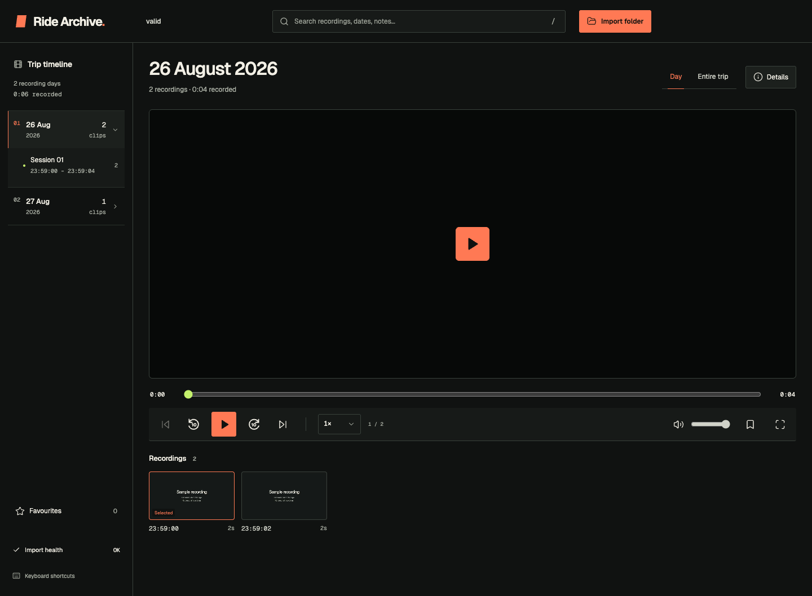
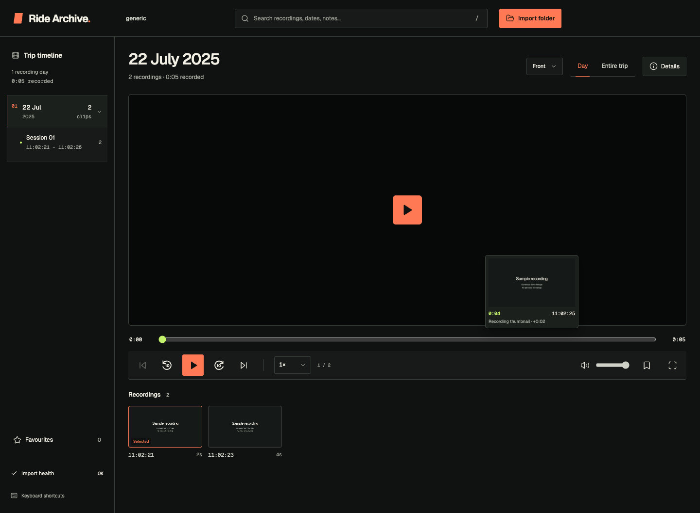
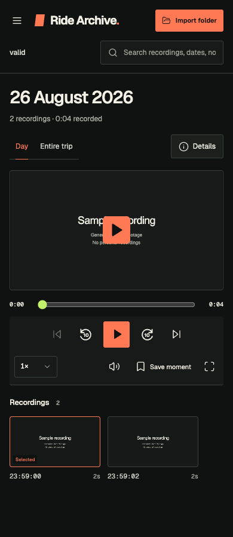
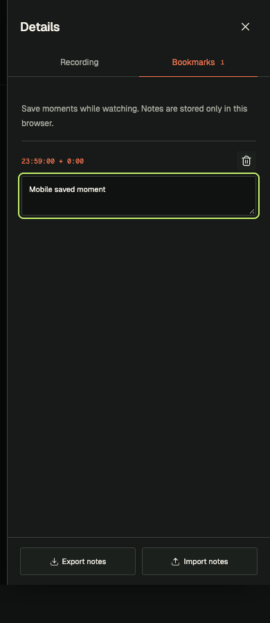

# Ride Archive

Watch a dashcam trip as one continuous journey instead of opening every recording separately.

Ride Archive is a local browser app that turns a folder of video segments into a day-by-day timeline. Import recordings, select a camera view, play through the trip, and save important moments. Your footage stays in its original folder.

## Features

- **Continuous playback:** automatically advance through clips of any duration, for one day or the entire trip.
- **Trip timeline:** browse recording days, sessions, and camera-off gaps.
- **Camera views:** separate recognized front, rear, and interior streams.
- **Seek previews:** see a recording's supplied thumbnail while hovering, dragging, or using the keyboard.
- **Saved moments:** bookmarks, notes, favourites, and search.
- **Date corrections:** adjust a session's timeline without renaming or editing files.
- **Import review:** distinguish warnings from unreadable or ambiguous recordings; explicitly recover playable videos.
- **Local persistence:** resume playback and export/import notes and corrections as JSON.
- **Accessible controls:** keyboard navigation, fullscreen playback, and responsive drawers.

## Screenshots

These are screenshots of the working app using generated test footage. The dark video with “Sample recording” text is demo content; no personal trip recordings are included.

### Desktop timeline and continuous player



### Thumbnail preview while seeking



### Mobile playback and saved moments

| Player                                                                                                                                      | Bookmarks and notes                                                                                                                            |
| ------------------------------------------------------------------------------------------------------------------------------------------- | ---------------------------------------------------------------------------------------------------------------------------------------------- |
|  |  |

## Quick start

Use Node.js 22 or newer and npm. The project has been verified with Node.js 22.14.0.

From the repository directory:

```sh
npm ci
npm run dev
```

Open the URL printed by Vite, usually [http://127.0.0.1:5173](http://127.0.0.1:5173). Desktop Chrome or Edge is the primary supported workflow.

1. Click **Import folder** and select the recording folder, including any nested camera directories.
2. Review the import results. If some videos cannot be imported, choose **Recover playable videos** to keep the readable recordings.
3. Select a day and press Play. Choose **Entire trip** to continue across days.
4. Use **Details** for notes, favourites, date corrections, and annotation backups.

TXT files are ignored. Thumbnails are optional. Nothing is uploaded, renamed, or modified by the app.

## What files work?

The importer recognizes MP4, MOV, M4V, WebM, AVI, MKV, TS, MTS, and M2TS as video candidates. **Actual playback depends on the browser's container and codec support.** Recognizing an extension does not mean every video using it will play.

JPG/JPEG, PNG, and WebP thumbnails can share the video's stem or use supported thumbnail suffixes. Nested folders are supported:

```text
trip/
├── front/
│   ├── 20250722_110221_NF.mp4
│   └── 20250722_110221_NF.jpg
└── rear/
    ├── 20250722_110221_NR.mp4
    └── 20250722_110221_NR.jpg
```

Recording dates come from recognized filename patterns, embedded movie creation time, or an explicitly labelled file-date fallback. The app does not require a specific dashcam brand.

See the [project guide](docs/PROJECT_GUIDE.md) for filename patterns, thumbnail matching, timestamp rules, troubleshooting, and architecture.

## How it works

The browser reads the selected folder with read-only file access. A Web Worker indexes filenames, dates, camera channels, and thumbnail matches. Browser video elements inspect each candidate's duration and readability before import.

The player builds a chronological queue from the imported index and uses local object URLs to access the current and next video. A cumulative seek position maps back to a clip and an offset within that clip. Recording gaps remain visible in the timeline but do not add blank playback time.

Trip indexes and annotations live in IndexedDB through Dexie. A small localStorage checkpoint protects the latest playback position during an immediate reload. The app has no upload API, account system, or backend database.

## Development

| Command                | Purpose                                                |
| ---------------------- | ------------------------------------------------------ |
| `npm run dev`          | Start the local development server                     |
| `npm test`             | Run unit and storage tests                             |
| `npm run test:browser` | Generate small fixtures and run browser tests          |
| `npm run build`        | Type-check and build the static app into `dist/`       |
| `npm run preview`      | Preview the production build locally                   |
| `npm run format`       | Format application code, tests, and root configuration |
| `npm run format:check` | Check the same files without changing them             |

Browser tests need **FFmpeg** and an installed **Google Chrome**. These are development-test requirements, not runtime requirements for the app.

The implementation uses React, TypeScript, Vite, Dexie, and Lucide icons. Testing uses Vitest, fake-indexeddb, and Playwright. The interface uses the [CodeWhen](https://www.codewhen.com/) design language and locally hosted Geist fonts.

## Privacy and limitations

- Selecting a folder does not upload its contents. Media is read directly from disk.
- Site storage belongs to the browser profile and origin. Changing the host/port or clearing storage can make the existing library unavailable; export notes as a backup.
- Reopening the app may require folder permission or selecting the original folder again.
- Seek images are representative clip thumbnails, not frame-accurate previews for every second.
- Native clip changes can have small playback gaps. Frame-perfect transitions are not guaranteed.
- Proprietary/encrypted formats, unsupported codecs, video repair, transcoding, GPS maps, cloud sharing, and merged-video export are not provided.

## Contributing

Read the [project guide](docs/PROJECT_GUIDE.md#contributing) for the code layout, test workflow, and suggestions for camera compatibility reports. Use synthetic fixtures where possible; a personal trip recording is not needed for most changes.

## License

A project license has not been specified yet. No `LICENSE` file is currently included.
