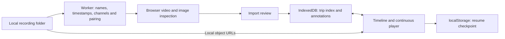

# Ride Archive: project guide

This guide explains what Ride Archive is, how to use it, and how its implementation works. It is intended for users, contributors, and maintainers.

[Back to the README](../README.md)

## What is Ride Archive?

Dashcams split footage into short recordings. A single journey can become hundreds of files, making it difficult to watch the trip, find a moment, or understand where recording stopped and resumed.

Ride Archive turns that folder into one navigable library. It groups recordings into days and sessions, keeps recognized camera streams separate, and advances through the selected recordings automatically. It also provides bookmarks, notes, favourites, date corrections, and annotation backups.

The product is a browser app for local footage. It is not a dashcam connection service, a video editor, or a cloud storage system.

## Getting started

### Requirements

- Node.js 22 or newer and npm for running or building the project. Node.js 22.14.0 has been used for verification.
- Desktop Chrome or Edge for the primary folder-access workflow.
- A folder containing video recordings. Matching thumbnails improve browsing but are not required.

Install and start from the repository directory:

```sh
npm ci
npm run dev
```

Use the URL printed by Vite. The development server binds to the local loopback address by default.

### Import a trip

1. Click **Import folder**.
2. Choose the original recording folder. Nested directories are scanned automatically.
3. Wait for indexing and video inspection. The progress display can be cancelled.
4. Review the results and import the trip.

A strict import is blocked by empty, unreadable, or ambiguous video files. **Recover playable videos** is an explicit alternative that excludes those files and retains the readable recordings. Missing thumbnails and estimated dates are warnings; they do not block otherwise usable footage.

Cancelling before import commits no trip index. The report can be downloaded for inspecting affected filenames.

If the regular folder picker does not work, expand **Folder access options** and use the compatibility picker. This mode requires selecting the folder again after reopening the app.

### Watch the trip

Select a day or session in the timeline and press Play. Playback defaults to the selected day. **Entire trip** creates a queue across the recording days for the selected camera stream.

The seek bar measures recorded footage, not total elapsed wall-clock time. A two-hour break between recordings appears as a timeline gap and is skipped during playback. The seek bar can move across clip boundaries without opening individual files.

If multiple camera views are recognized, use the camera selector. Front, rear, and interior views have separate queues. Switching views chooses a nearby indexed recording; the app does not provide synchronized multi-camera playback.

Hover, drag, or use the seek bar with the keyboard to show the matching recording's thumbnail and target time. A supplied image represents its recording as a whole. It is not an extracted frame from the precise seek position.

### Save and find moments

Use the player bookmark button or **Save moment** to save a timestamp. The Bookmarks section in **Details** lets you edit or remove its note. Recording favourites are also available in Details.

Search matches filenames, displayed dates, and saved note text in the selected camera stream. The timeline's Favourites control filters saved favourite recordings.

Use **Export notes** to save a JSON backup. **Import notes** merges matching annotations and corrections. Backups contain recording identifiers, notes, and corrections—not the videos themselves.

### Correct camera dates

A camera clock may be wrong, or an unknown filename may require a file-date fallback. Open **Details → Correct session time** and enter the desired session start.

The app applies an offset to the original session. Timeline grouping updates, while filenames and original indexed timestamps remain unchanged. **Reset** reverses that session's correction.

### Keyboard controls

| Key          | Action                                                             |
| ------------ | ------------------------------------------------------------------ |
| Space        | Play or pause                                                      |
| Left / Right | Seek backward or forward ten seconds                               |
| F            | Toggle fullscreen                                                  |
| /            | Focus search when a trip is loaded                                 |
| Escape       | Dismiss an open dialog/menu or exit fullscreen, depending on focus |

Global player shortcuts do not intercept typing or focused form controls. Selector menus support arrows, Home/End, Enter/Space, type-ahead, Escape, and Tab. On small screens, drawers contain keyboard focus and restore it when dismissed.

## Files, dates, and cameras

### Video candidates

The importer considers these extensions, case-insensitively:

```text
.mp4 .mov .m4v .webm .avi .mkv .ts .mts .m2ts
```

This is a discovery list, not a decoder support list. Browser metadata/readability checks determine which candidates can be indexed. A file may still fail during playback: metadata inspection does not validate every encoded frame.

The app reports unsupported or damaged video and suggests converting a copy to H.264/AAC MP4 for wider compatibility. It does not perform conversion or repair itself. Clip lengths are read from the media, with no one-minute assumption.

Hidden files/directories and non-video/non-image sidecars are ignored. TXT content is never parsed. Garmin GLV proxy files are not included alongside the MP4 recordings.

### Timestamp precedence

The indexer uses the first available source:

1. **Filename timestamp:** recognized calendar date and time in the recording name.
2. **Embedded movie creation time:** MP4/MOV/M4V movie headers, read through small file slices rather than loading the whole video.
3. **File modified time:** interpreted in the browser's local timezone and explicitly marked as estimated.

Common recognized shapes include:

| Shape                             | Example                         |
| --------------------------------- | ------------------------------- |
| Compact date and time with suffix | `20250722_110221_NF.mp4`        |
| Year plus month/day block         | `2025_0722_110221_000123F.mp4`  |
| Separated date and time           | `REC_2025_07_22_11_02_21_F.mp4` |
| Prefixed date/time and sequence   | `NO20250722-110221-000123R.mp4` |
| Contiguous date/time              | `VID_20250722110221.mp4`        |
| Two-digit year                    | `250722_110221_001_FH.mp4`      |

Two-digit years are interpreted as 20YY. These shapes do not imply that every model from a manufacturer has been tested.

Filename timestamps are treated as camera wall-clock values without guessing a geographic timezone. Embedded time is displayed as the extracted creation time; it is not proof that a camera clock was accurate. File modified time can change during copying or exporting. Details shows the time source so users can verify or correct it.

### Channels and sessions

Common filename suffixes and directory names identify front, rear, and interior recordings. Garmin `GC1` and `GC2` prefixes are also recognized. Files without a recognized channel stay in the unlabelled stream.

Within each camera stream, a session starts at a recording-day boundary or after a gap greater than five minutes from the previous clip's end. Actual duration is used when measuring that gap.

Same-stem videos in the same directory are ambiguous and excluded. The same filename in different directories can represent distinct recordings. Identical high/low-quality exports should not be mixed into a queue; the app does not perform general duplicate-content detection.

### Thumbnail matching

Supported image extensions are JPG/JPEG, PNG, and WebP. Matching is case-insensitive. Accepted names include:

```text
recording.mp4  +  recording.jpg
recording.mp4  +  recording_thumb.png
recording.mp4  +  recording_thumbnail.webp
recording.mp4  +  recording_preview.jpg
recording.mp4  +  thumb_recording.jpg
recording.mp4  +  thumbnail_recording.jpg
recording.mp4  +  recording.mp4.jpg
```

The importer prefers a matching image in the recording's directory. A separate thumbnail folder can be used when the basename identifies one video and one image unambiguously. When multiple images match, the app does not guess. Missing or undecodable images use a placeholder and do not prevent video playback.

## How the implementation works



### Folder access and indexing

The File System Access API enumerates a user-selected directory with read-only permission. Where unavailable, a directory file input provides a compatibility path.

The browser sends file references to a Web Worker. The worker discovers videos and images, parses naming patterns, resolves timestamp sources, identifies channels, and pairs thumbnails. It returns candidates and import notices; it does not upload or copy the footage into application storage.

The importer then uses up to four concurrent browser media probes to read actual durations and video dimensions. Supplied thumbnails are checked for decoding errors. Cancellation stops the work, and the trip is saved only after an explicit import or recovery action.

### Timeline and playback

The trip index contains file references, timestamps, durations, channels, and session identifiers. Date corrections are applied when deriving the displayed days and sessions.

The selected day/trip and camera stream determine the playback queue. Each clip contributes its real duration to a cumulative timeline. Seeking locates the clip containing that cumulative position, then computes the offset within it.

A native HTML video element plays the current clip. A second element preloads the next one. Clip completion advances the queue while retaining playback speed and volume. Object URLs are released when their corresponding media leaves use.

The filmstrip and search results render a bounded visible range rather than every item at once. Only the thumbnail needed for a seek preview is opened for that preview. These choices keep browsing practical for large folders without merging or transcoding the recordings.

### Saved data

| Storage                 | Contents                                                                                                           |
| ----------------------- | ------------------------------------------------------------------------------------------------------------------ |
| Original folder         | Video and thumbnail source files; unchanged                                                                        |
| In-memory file library  | Current file references or the connected directory handle                                                          |
| IndexedDB through Dexie | Trip indexes, import notices, bookmarks, notes, favourites, corrections, resume data, and supported folder handles |
| localStorage            | Small validated resume checkpoint for an immediate reload                                                          |
| Exported JSON           | Recording IDs/sizes, annotations, and date corrections                                                             |

The database includes an upgrade path that removes earlier TXT-derived fields without discarding saved annotations. JSON backup imports match recordings by ID and size, validate the values, and merge entries rather than blindly replacing the whole library.

### Code layout

```text
src/
├── App.tsx                 Library state and workspace composition
├── components/             Player, seek previews, selectors, drawers and dialogs
└── core/
    ├── camera.ts           Filename/channel adapters and embedded time extraction
    ├── indexer.ts          File pairing, notices, sessions and queue calculations
    ├── index.worker.ts     Worker entry point
    ├── importer.ts         Browser media checks and import orchestration
    ├── files.ts            Folder access and local file/object references
    ├── db.ts               IndexedDB schema and upgrades
    ├── resume.ts           Immediate-reload playback checkpoint
    ├── backup.ts           Annotation backup matching and validation
    └── types.ts            Shared data structures
tests/                      Unit and storage tests
e2e/                        Browser acceptance tests
scripts/                    Synthetic fixtures and reference diagnostics
public/fonts/               Locally hosted fonts
```

## Privacy and hosting

The application has no upload endpoint, user account system, or server-side video database. Application assets load from the origin serving the app; folder selection and playback use local file references. In development, Vite also maintains its normal development connection.

Indexes and annotations belong to a browser profile and origin. Opening the app under a different host/port, using another browser, or clearing site storage does not transfer that library. Export notes and keep the source recordings separately.

Build and preview locally:

```sh
npm run build
npm run preview
```

`dist/` is a static application that can be served by a static host. Persistent folder access requires a supported browser and a secure context such as HTTPS or localhost. Hosting the application does not make the user's selected footage accessible to other visitors.

Do not put source footage in `public/` as part of deployment. The runtime reads a selected local folder; distributing recordings is a separate action.

A responsive phone layout is provided, but desktop is the primary tested workflow. Mobile folder selection, permissions, and media decoding depend on the browser/device.

## Troubleshooting

| Problem                                        | What to do                                                                                                            |
| ---------------------------------------------- | --------------------------------------------------------------------------------------------------------------------- |
| A recording will not play                      | Check the import report. The container/codec may be unsupported or the file damaged; try a compatible converted copy. |
| The timeline shows the wrong date              | Check the time source in Details and correct the session start.                                                       |
| A seek preview is missing                      | Check the image filename and matching rules. A missing thumbnail does not block playback.                             |
| The library exists but footage is unavailable  | Use **Reconnect folder** and choose the original recordings.                                                          |
| A file changed on disk                         | Reimport the folder to update its index. Size and modified time are checked when reopening a recording.               |
| Files appear twice or alternate unexpectedly   | Check the selected camera stream and avoid mixing proxy/duplicate exports into the source set.                        |
| Folder selection fails                         | Use **Folder access options → Use compatibility folder picker**.                                                      |
| Notes are absent in a different browser/origin | Use the annotation export/import workflow; browser storage is not synchronized.                                       |
| There is a brief transition between clips      | Native file switching is automatic but not guaranteed to be frame-perfect.                                            |

## Contributing

### Run checks

```sh
npm ci
npm test
npm run build
npm run format:check
```

For browser acceptance tests, install FFmpeg and Google Chrome, then run:

```sh
npm run test:browser
```

The fixture script generates small test recordings in the operating system's temporary directory. FFmpeg is used by tests; it is not bundled into the app.

An optional read-only test can inspect a local recording folder:

```sh
REFERENCE_FOLDER='/absolute/path/to/recordings' npm run test:browser -- --grep 'reference folder'
```

The current reference test contains expectations for the maintainer's specific fixture counts and a known filename. Adapt those expectations for another dataset; this command is not a universal folder validator.

### Make a focused change

- Keep existing annotations and file references compatible when changing IDs, schemas, or import behavior. Add a migration when storage changes require it.
- Add focused regression coverage for parsing, queue, persistence, or interaction behavior. For documentation-only changes, check formatting and links instead of rerunning media tests unnecessarily.
- Use synthetic files for reproducible fixtures. Do not require contributors to share personal journey footage.
- Keep camera adapters independent of the UI. Include an anonymized filename/folder example and expected channel/time when adding a naming convention.
- Preserve read-only source access and the distinction between import errors and recoverable warnings.
- Verify UI changes on desktop and at narrow widths, including keyboard interaction and fullscreen when relevant.

Useful issue details include browser/OS versions, file extension and codec if known, an anonymized filename pattern, folder layout, expected behavior, and the import report message. A full personal video is not required for an initial report.

### Current boundaries

The project does not currently provide GPS mapping, synchronized multi-camera playback, proprietary/encrypted video decoding, transcoding, video repair, merged export, or cloud sharing. Keep proposed additions explicit rather than implying these capabilities already exist.

## License status

No `LICENSE` file is currently included. The project's license has not been specified; this guide does not select or grant one.
